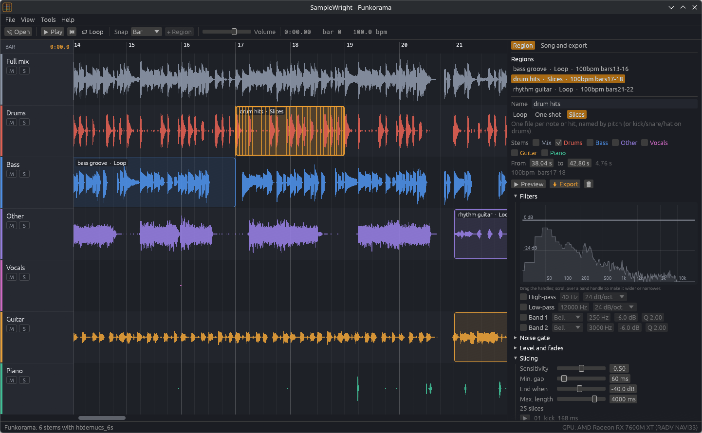
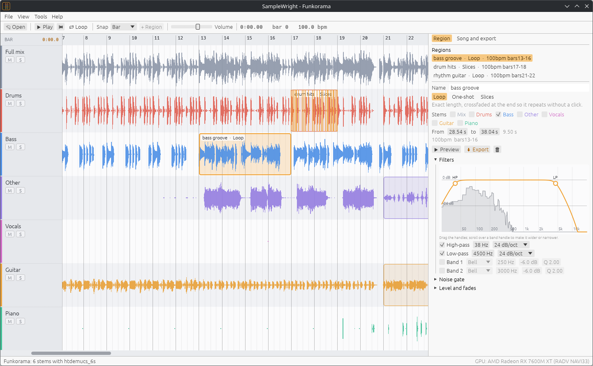

#  SampleWright

Separate any song into stems, then cut loops, one-shots and single notes out
of them for your DAW. Everything runs on your own computer, on its GPU, in a
normal desktop app. You don't need Python or a command line, and nothing is uploaded.



> **Early access (v0.x).** The core workflow works: separation, bar-snapped
> regions, the cleanup filters, slicing and export. Expect rough edges, and
> please report what you find. MIDI export, time-stretching and sampler
> kit export are planned (see [Roadmap](#roadmap)).

## What it does

1. **Open a song** (mp3, flac, wav, ogg, m4a, aiff). SampleWright splits it into
   stems with [Demucs v4](https://github.com/facebookresearch/demucs), the
   best open source separator. Choose between:
   - **6 stems:** drums, bass, vocals, guitar, piano and other
   - **4 stems, best quality:** drums, bass, vocals and other
   - **4 stems, fast**

   It also finds every beat and bar line with
   [Beat This!](https://github.com/CPJKU/beat_this). Each song is separated
   once: the stems are kept, so it opens instantly next time.
2. **Select** a stretch on one or more stem lanes. The selection snaps to bars
   or beats, so a 4-bar loop really is 4 bars long. Press Enter to make it a region.
3. **Clean it up.** Each region has its own chain: high-pass and low-pass (12, 24
   or 48 dB/oct) and two bell or notch bands. You set them by dragging handles over the
   region's live spectrum. There's also a noise gate for the bleed between notes,
   plus gain, fades and normalising. **Preview** plays the region on loop exactly as
   it will export, and updates as you turn the knobs.
4. **Export** each region as:
   - **Loop:** exact length, with a short crossfade at the end so it repeats
     without a click and stays in time in your DAW
   - **One-shot:** a single sample starting on a zero crossing, with fades
   - **Slices:** one file per note or hit, found by onset detection. Bass
     and melodic notes are named by pitch (`bass_07_E1.wav`); drum hits are
     sorted into kick, snare and hat.

Files are named so your DAW's browser explains them:
`Funkorama_bass groove_100bpm_bars13-16.wav`. You can export WAV at 16-bit,
24-bit or 32-bit float, at 44.1 or 48 kHz, in stereo or mono. Multi-stem regions
can be one mixed file or one file per stem. **Export full stems** writes every
stem at full length for remixing.



## Getting it

Download the bundle for your system from the
[latest release](https://github.com/Imdabossou/SampleWright/releases):

- **Linux:** an `.AppImage`, or a `.tar.gz`
- **Windows:** a `.zip`
- **macOS (Apple Silicon):** a `.zip` holding the `.app`

On first start, SampleWright offers to download its AI models:
55 MB for 6-stem separation plus 83 MB for beat tracking. Each file is checked
by size and SHA-256. The other models are downloaded when you first pick them
(see [docs/MODELS.md](docs/MODELS.md)). If you use
[FretWright](https://github.com/Imdabossou/FretWright), its downloaded models
are found and reused.

**GPU:** separation runs on any GPU with Vulkan (Linux, Windows), Metal (macOS)
or DX12. Expect about a minute for a 3 to 4 minute song on a mid-range card; the first
run is a little slower while the GPU kernels are tuned. Without a usable GPU it
runs on the CPU, which is several times slower. To force the CPU, use Tools > Separate on the CPU.

## Using it

| | |
|---|---|
| Drag on lanes | select; drag across several lanes to take several stems |
| Alt + drag | select without snapping |
| Enter | make a region from the selection |
| Drag a region / its edges | move / resize it (snapped) |
| Double-click a region, or P | preview it on loop |
| Space | play / pause the song (stops a preview) |
| L | loop playback over the selection or region |
| M / S buttons | mute / solo a lane while you listen |
| Ctrl + scroll, or pinch | zoom; scroll moves along the song |
| Ctrl+E | export the selected region |

**Tips for clean samples**

- **Bass:** high-pass at 35 to 40 Hz takes out the kick drum that leaks into the
  bass stem; a low-pass at 4 to 5 kHz removes cymbal wash.
- **Guitar or keys:** high-pass at 100 to 150 Hz removes bass bleed. Add the
  *Other* stem to a guitar region if part of the guitar ended up there.
- **One-shots:** the noise gate silences the faint bleed between notes. It opens
  a few milliseconds before each note, so attacks are never clipped.
- **Drums:** a high-pass at 5 kHz before slicing finds the hats alone; a
  low-pass at 150 Hz finds the kicks.

**What separation can't do:** a strummed chord comes out as one sound, not as
its separate notes, so chords make loops and one-shots, not single-note
slices. Separated stems also carry some artefacts and bleed; the filters and
gate exist to clean that up.

## Command line

`samplewright-cli` does the same from a terminal (it ships in every bundle):

```sh
samplewright-cli models download            # the default models
samplewright-cli separate song.mp3 --model htdemucs_ft
samplewright-cli loop song.mp3 --stems bass --bars 9-12 --hp 38 --normalize
samplewright-cli slice song.mp3 --stems drums --bars 17 --out kit/
samplewright-cli stems song.mp3 --format 16 --rate 48000
```

Run it without arguments for every option.

## Roadmap

- MIDI export of bass and lead lines (pitch tracking per note)
- key detection, and time-stretched export to a target tempo
- sampler kit export (SFZ, and drum racks from slices)
- spectral selection (draw on a spectrogram to keep or remove parts)
- bleed reduction that uses the other stems, and model-based drum splitting
- dragging regions straight into a DAW

## Building from source

Install [Rust](https://rustup.rs), then:

```sh
./run.sh               # build and start the app
./run.sh cli --help    # the command line tool
cargo test --workspace --release
cargo xtask package    # a release bundle in dist/
```

Linux builds need the ALSA headers (`libasound2-dev` on Debian/Ubuntu,
`alsa-lib` on Arch).

## Licence

SampleWright is free software under the
[GNU General Public License v3.0 or later](LICENSE). You can use, study, share
and change it. If you share a changed version, it has to stay open source under
the same licence.

It builds on others' work, credited in [LICENSES/](LICENSES/README.md) and in
`THIRD_PARTY_LICENSES.txt` in each release:

- Demucs v4 (Meta, MIT), run by the vendored
  [demucs-rs](https://github.com/nikhilunni/demucs-rs) (Apache-2.0)
- Beat This! (JKU Linz, MIT)

**About the music you sample:** SampleWright is a tool. Whether you may
publish something made from a recording depends on that recording's rights,
not on the software. Sample your own music, Creative Commons music, or
recordings you have cleared.

Screenshots show "Funkorama" by Kevin MacLeod (incompetech.com), licensed
under [Creative Commons: By Attribution 4.0](https://creativecommons.org/licenses/by/4.0/).
