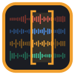
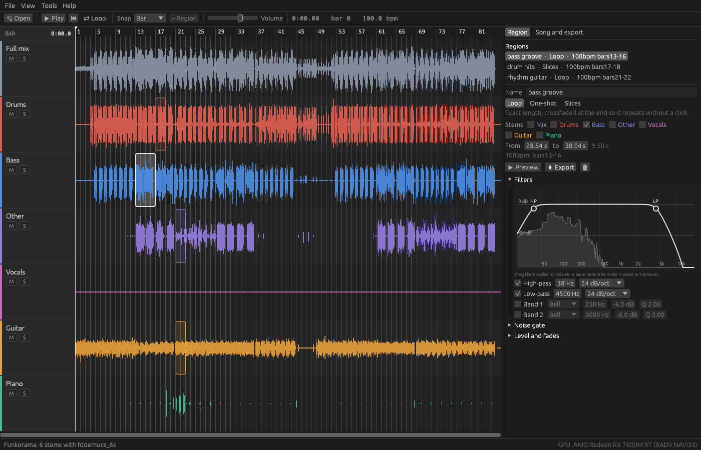
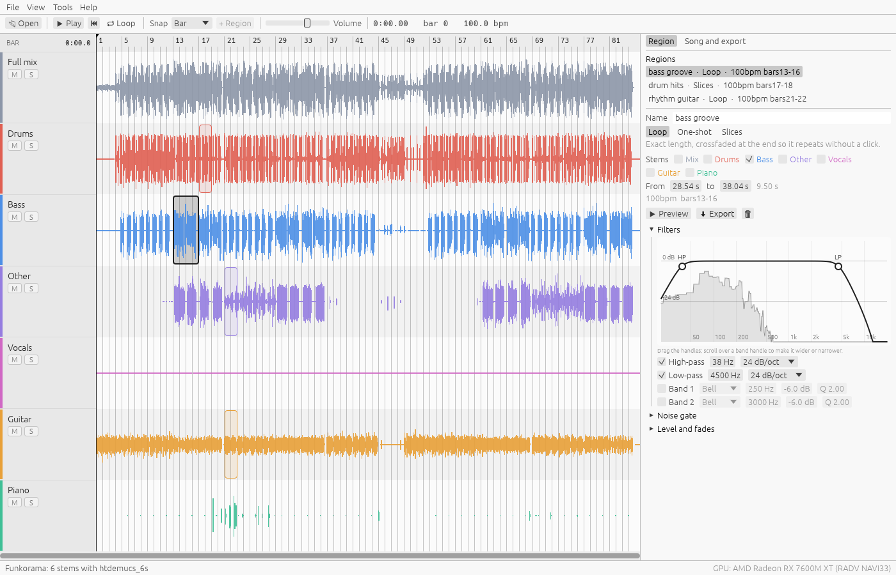

#  SampleWright

**Split any song into stems, then cut loops, one-shots and single notes for your DAW.**

Everything runs on your own computer, on its GPU, in a normal desktop app. No Python, no command line, and nothing is uploaded.

> **Early access (v0.x).** The core workflow works. Expect rough edges, and please report what you find.

## Features

- **Separate any song** into 6 stems (drums, bass, vocals, guitar, piano, other) or 4, with Demucs v4
- **Bar-perfect selections**: beats and bars are found for you, so a 4-bar loop really is 4 bars
- **Clean up each sample**: filters you drag over a live spectrum, a noise gate, fades and normalising
- **Export loops, one-shots or slices**: seamless loops, and slices named by pitch or sorted into kick, snare and hat
- **DAW-friendly file names**, like `Funkorama_bass groove_100bpm_bars13-16.wav`
- **Fast on any GPU**: about a minute per song on a mid-range card, with a CPU fallback
- **Light and dark themes** that follow your system

## Download

Get the bundle for your system from the [latest release](https://github.com/Imdabossou/SampleWright/releases):

- **Linux:** `.AppImage` or `.tar.gz`
- **Windows:** `.zip`
- **macOS (Apple Silicon):** `.zip` holding the `.app`

On first start it offers to download its AI models (about 140 MB). The [user guide](docs/guide.md) covers the workflow, controls, tips and the command-line tool.

## Licence

Free and open source under the [GNU GPL v3 or later](LICENSE). It builds on Demucs v4 (Meta, MIT) through [demucs-rs](https://github.com/nikhilunni/demucs-rs) (Apache-2.0) and Beat This! (JKU Linz, MIT); full credits are in [LICENSES/](LICENSES/README.md).

**About the music you sample:** whether you may publish something made from a recording depends on that recording's rights, not on the software. Sample your own music, Creative Commons music, or recordings you have cleared. Screenshots show "Funkorama" by Kevin MacLeod (incompetech.com), licensed under [CC BY 4.0](https://creativecommons.org/licenses/by/4.0/).

Want to build it yourself? See [BUILDING.md](BUILDING.md).
